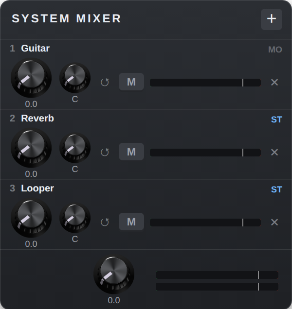

# System Mixer

One mixer at the end of a [MOD](https://mod.audio) pedalboard (MOD Dwarf, MOD
Desktop): right-click any plugin and choose **Send to mixer** instead of
dragging two cables from every plugin to the outputs. Each plugin gets a
channel with gain, pan, mute and a level meter, and the pedal only shows the
channels in use. Up to 16 mono or stereo plugins, at a fraction of the CPU of
MOD's own mixers.

**[Install](#install) · [Manual (PDF)](docs/manual/sysmixer-manual.pdf) · [Releases](https://github.com/stefdoerr/sysmixer/releases/latest) · [Building & contributing](DEVELOPERS.md)**



## What it does

- **Send to mixer / Remove from mixer** in a right-click menu on any plugin,
  or the **+** button on the mixer for a list of everything not yet sent. A
  stereo plugin uses both sides of a channel; a mono plugin plays in the
  middle. Sending unplugs the plugin's direct cables to the system outputs,
  so nothing is heard twice; removing just unplugs it from the mixer.
- **A pedal that grows with use:** an empty mixer is a header and a master
  knob; every send adds one slim row named after the plugin, marked ST or MO.
- **Per channel:** gain (−60 dB = off … +12 dB, value shown under the knob),
  pan (constant power for mono, balance for stereo), mute, reset, a pre-fader
  meter and ✕ to remove. **Master** gain with left/right meters.
- **Teleported sends on [starless](https://github.com/sejerpz/alabs-mod-custom-images):**
  each send becomes a named cable teleport instead of a cable across the board.
  On other MOD firmware the sends are ordinary cables and everything else works.
- **Footswitches and knobs:** every mute, gain and pan can be assigned from the
  pedal's settings (cogwheel), like any plugin control.

The routing lives entirely in the plugin's own modgui script, so it needs no
changes to MOD-UI. It uses MOD-UI's page and HTTP endpoints rather than an
official plugin API (there isn't one for menus or connections), so a future
MOD-UI could break the menu — never the audio, which is plain LV2.

## CPU

Measured on a MOD Dwarf with [`tools/lv2bench.c`](tools/lv2bench.c): 128-frame
blocks at 48 kHz, every input fed with noise, median per block.

| Plugin | Channels | Median per block |
|---|---|---|
| MOD Mixer (mono) | 4 mono | 140 µs |
| MOD Mixer Stereo | 4 stereo | 287 µs |
| ABotte Sounds mixer-4x2 | 4 stereo | 58 µs |
| **System Mixer** | **16 stereo** | **31 µs** (about 1.2 % of the audio period) |

## Install

Grab the latest bundle for your device from the
**[Releases page](https://github.com/stefdoerr/sysmixer/releases/latest)**.
Replace `X.Y.Z` below with the version you downloaded. The plugin appears
under brand **Stefan** as **System Mixer**.

### MOD Dwarf

```bash
tar xf sysmixer-vX.Y.Z-dwarf-aarch64.tar.gz
scp -O -r sysmixer.lv2 root@192.168.51.1:/root/.lv2/
ssh root@192.168.51.1 'systemctl restart jack2 mod-ui'
```

Then hard-refresh the MOD web interface (Ctrl-Shift-R).

### MOD Desktop (Linux)

```bash
tar xf sysmixer-vX.Y.Z-linux-amd64.tar.gz
cp -r sysmixer.lv2 ~/"Documents/MOD Desktop/lv2/"
```

Restart MOD Desktop.

## Manual

The [PDF manual](docs/manual/sysmixer-manual.pdf) covers every control,
sending and removing, assigning footswitches, and common questions.

## Building

Built with [DPF](https://github.com/DISTRHO/DPF) from the
[mod-plugin-template](https://github.com/stefdoerr/mod-plugin-template):
`make` for a host build, `make test` for the DSP tests, `make dwarf` to
cross-compile and deploy to a connected Dwarf. See [DEVELOPERS.md](DEVELOPERS.md).
